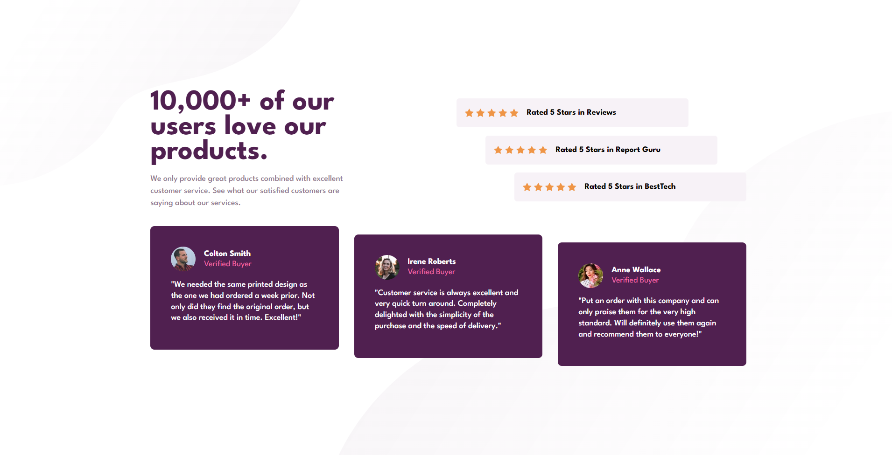
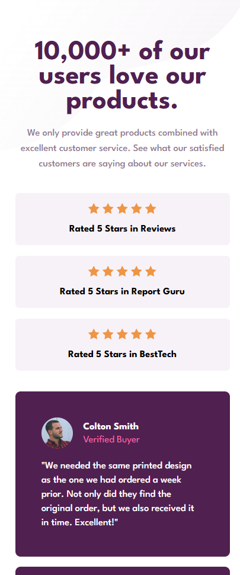

# Social proof section

[Versión en español](./README.md)

Solution to the [Social proof section challenge on Frontend Mentor](https://www.frontendmentor.io/challenges/social-proof-section-6e0qTv_bA). The goal was to reproduce the design with semantic HTML and responsive CSS, starting with the mobile version and progressively adapting the composition for desktop.

## Screenshots

### Desktop

### Mobile

## Links

- [Live site](https://jesusaid.github.io/Social-Proof-Section/)
- [Repository](https://github.com/JesuSaid/Social-Proof-Section)
- [Frontend Mentor challenge](https://www.frontendmentor.io/challenges/social-proof-section-6e0qTv_bA)

## The challenge

Users should be able to view an appropriate content layout for their screen size. The interface includes an introduction, three five-star ratings, and three testimonials from verified buyers.

## Technologies and techniques

- Semantic HTML5.
- CSS custom properties.
- Mobile-first workflow.
- Flexbox for lists, ratings, and card distribution.
- CSS Grid for testimonial internals and the desktop layout.
- Logical properties such as `inline-size`, `padding-inline`, `margin-block-start`, and `min-block-size`.
- Local League Spartan font files in weights 400, 500, and 700.
- Multiple background images for the decorative patterns.
- A `min-width` media query for progressive desktop enhancement.

## Development process

The content was first organized with a single `h1`, sections identified by `h2` headings, lists for the ratings and testimonials, and `blockquote` elements for customer quotes. Section headings remain available to assistive technologies through an `sr-only` class.

The visual foundation was then created with color and typography tokens, `box-sizing: border-box`, and local League Spartan declarations. The mobile version was built one block at a time: introduction, ratings, testimonials, and decorative backgrounds.

On desktop, `main` changes from Flexbox to Grid. The introduction and ratings occupy the first row, while the testimonials span every column in the second row. Ratings use proportional widths and offsets, and testimonials are distributed in one row with vertical staggering.

## What I learned

### Semantic HTML and accessibility

- A `section` should have a heading that identifies its content, even when that heading is not visible in the design.
- `blockquote` communicates the meaning of a testimonial better than a generic paragraph.
- Stars and customer portraits use `alt=""` because the necessary information is already expressed by nearby text.
- Visually hidden headings should remain available to screen readers.

### Responsive design

- `width: 100%` depends on the width of the parent, so section widths had to be established first.
- A `min-width` can create horizontal scrolling on narrow screens. Fluid containers with side padding allow cards to shrink safely.
- `min-block-size` preserves a minimum height while allowing content to grow with zoom or larger text.
- Breakpoints were chosen according to the space required by the content. The mobile layout remains active at 768px, and the desktop layout starts at `64rem`.

### Flexbox and Grid

- `align-content` controls the distribution of complete Grid tracks. It prevented automatic rows from stretching inside a `100vh` container.
- `align-items: stretch` made staggered testimonial cards end at the same position. `align-items: flex-start` lets each card retain its own height.
- `flex: 1 1 0` distributes available space evenly between testimonial cards.
- Rating cards occupy 80% of their list and use offsets of 0%, 10%, and 20%, allowing the last card to end within the available 100%.

### CSS organization

- Class names distinguish collections from individual components, such as `customer-testimonials__list` and `card-testimonial`.
- Styles are scoped to their components to avoid unexpected global effects.
- The top and bottom decorative backgrounds use separate CSS layers and switch to desktop assets in the media query.

## Testing

The interface was visually reviewed at the following widths:

- 320px
- 375px
- 425px
- 768px
- 1024px
- 1280px
- 1440px

Horizontal overflow was checked throughout development, and `git diff --check` was run before commits.

## Continued development

- Validate the HTML and CSS with automated tools.
- Test the content at 200% and 400% zoom.
- Review the page with a screen reader and the browser accessibility tree.
- Continue practicing fluid layouts and content-driven breakpoints.

## AI collaboration

ChatGPT/Codex was used as a mentor during the project. The collaboration focused on reviewing semantics, explaining Flexbox and Grid, identifying possible overflow, reasoning about accessibility, and proposing Git milestones. The implementation was developed incrementally, testing and correcting each section before moving forward.

## Author

- GitHub: [@JesuSaid](https://github.com/JesuSaid)
- Frontend Mentor: [@JesuSaid](https://www.frontendmentor.io/profile/JesuSaid)

## Acknowledgments

- [Frontend Mentor](https://www.frontendmentor.io/) for providing the challenge, assets, and visual references.
- [MDN Web Docs](https://developer.mozilla.org/) and the [W3C Web Accessibility Initiative](https://www.w3.org/WAI/) as references for HTML, CSS, and accessibility.
