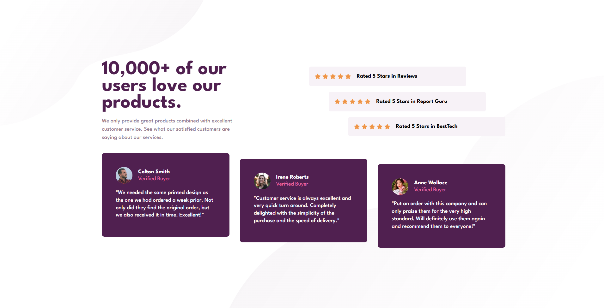
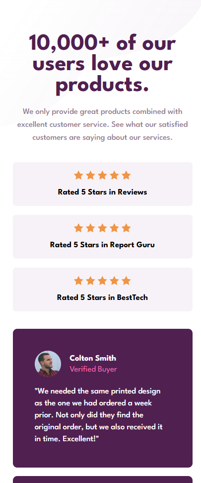

# Sección de prueba social

[English version](./README-en.md)

Solución al reto [Social proof section de Frontend Mentor](https://www.frontendmentor.io/challenges/social-proof-section-6e0qTv_bA). El objetivo fue reproducir el diseño con HTML semántico y CSS responsive, comenzando por la versión móvil y adaptando después la composición para escritorio.

## Capturas

### Escritorio

### Móvil

## Enlaces

- [Sitio publicado](https://jesusaid.github.io/Social-Proof-Section/)
- [Repositorio](https://github.com/JesuSaid/Social-Proof-Section)
- [Reto de Frontend Mentor](https://www.frontendmentor.io/challenges/social-proof-section-6e0qTv_bA)

## El reto

Los usuarios deben poder ver una distribución adecuada del contenido de acuerdo con el tamaño de su pantalla. La interfaz incluye una introducción, tres valoraciones de cinco estrellas y tres testimonios de compradores verificados.

## Tecnologías y técnicas

- HTML5 semántico.
- CSS con propiedades personalizadas.
- Flujo de trabajo mobile-first.
- Flexbox para listas, valoraciones y distribución de tarjetas.
- CSS Grid para la estructura interna de los testimonios y el layout desktop.
- Propiedades lógicas como `inline-size`, `padding-inline`, `margin-block-start` y `min-block-size`.
- Fuente local League Spartan en pesos 400, 500 y 700.
- Imágenes de fondo múltiples para los patrones decorativos.
- Media query con `min-width` para la mejora progresiva de escritorio.

## Proceso de desarrollo

Primero se organizó el contenido con un único `h1`, secciones identificadas mediante `h2`, listas para las valoraciones y testimonios, y elementos `blockquote` para las citas. Los títulos de sección se conservaron para tecnologías de asistencia mediante una clase `sr-only`.

Después se creó la base visual con tokens de color y tipografía, `box-sizing: border-box` y las declaraciones locales de League Spartan. La versión móvil se construyó por bloques: introducción, valoraciones, testimonios y fondos decorativos.

Para escritorio, `main` cambia de Flexbox a Grid. La introducción y las valoraciones ocupan la primera fila, mientras que los testimonios abarcan todas las columnas en la segunda. Las valoraciones usan anchos y desplazamientos proporcionales, y los testimonios se distribuyen en una fila con un escalonado vertical.

## Aprendizajes

### HTML semántico y accesibilidad

- Una `section` debe tener un encabezado que describa su contenido, aunque el diseño no lo muestre visualmente.
- `blockquote` comunica mejor el significado de un testimonio que un párrafo común.
- Las estrellas y los retratos usan `alt=""` porque la información necesaria ya está expresada por el texto cercano.
- Los encabezados ocultos visualmente deben permanecer disponibles para lectores de pantalla.

### Diseño responsive

- `width: 100%` depende del tamaño del elemento padre; por eso fue necesario definir primero el ancho de las secciones.
- Un `min-width` puede provocar scroll horizontal en pantallas estrechas. Los contenedores fluidos con padding lateral permiten que las tarjetas se reduzcan con seguridad.
- `min-block-size` permite respetar una altura mínima sin impedir que el contenido crezca con zoom o textos más largos.
- Los breakpoints se eligieron según el espacio requerido por el contenido, manteniendo 768px con el layout móvil y activando el layout desktop a partir de `64rem`.

### Flexbox y Grid

- `align-content` controla la distribución de las filas completas de Grid. Se utilizó para evitar que las filas automáticas se estiraran dentro de `100vh`.
- `align-items: stretch` hacía que los testimonios escalonados terminaran a la misma altura. `align-items: flex-start` permite que cada tarjeta conserve su altura.
- `flex: 1 1 0` reparte equitativamente el espacio entre las tarjetas de testimonios.
- Las valoraciones ocupan el 80% de su lista y usan desplazamientos de 0%, 10% y 20%, de modo que la última termina dentro del 100% disponible.

### Organización de CSS

- Las clases distinguen entre colecciones y componentes individuales, por ejemplo `customer-testimonials__list` y `card-testimonial`.
- Los estilos se mantienen limitados al componente para evitar efectos globales inesperados.
- Los fondos decorativos superior e inferior se declararon como capas CSS independientes y se intercambian por sus versiones desktop en la media query.

## Pruebas realizadas

La interfaz se revisó visualmente en los siguientes anchos:

- 320px
- 375px
- 425px
- 768px
- 1024px
- 1280px
- 1440px

También se comprobó que no hubiera scroll horizontal durante el desarrollo y se ejecutó `git diff --check` antes de los commits.

## Desarrollo futuro

- Validar el HTML y el CSS con herramientas automáticas.
- Probar el contenido con zoom al 200% y 400%.
- Realizar una revisión con lector de pantalla y árbol de accesibilidad.
- Seguir practicando layouts fluidos y breakpoints definidos por el contenido.

## Colaboración con IA

Se utilizó ChatGPT/Codex como mentor durante el proyecto. La colaboración se centró en revisar la semántica, explicar Flexbox y Grid, detectar posibles desbordamientos, razonar sobre accesibilidad y proponer hitos de Git. La implementación se desarrolló de forma incremental, probando y corrigiendo cada sección antes de continuar.

## Autor

- GitHub: [@JesuSaid](https://github.com/JesuSaid)
- Frontend Mentor: [@JesuSaid](https://www.frontendmentor.io/profile/JesuSaid)

## Reconocimientos

- [Frontend Mentor](https://www.frontendmentor.io/) por proporcionar el reto, los recursos y las referencias visuales.
- [MDN Web Docs](https://developer.mozilla.org/) y [W3C Web Accessibility Initiative](https://www.w3.org/WAI/) como referencias de HTML, CSS y accesibilidad.
